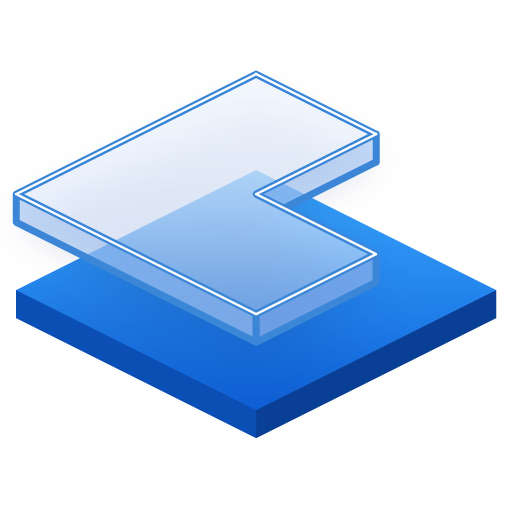

<p align="center">
  
</p>

<h1 align="center">OpenLamina</h1>

<p align="center">
  <a href="https://github.com/feimos-dev/OpenLamina/actions/workflows/build.yml"></a>
  <a href="https://github.com/feimos-dev/OpenLamina/releases"></a>
</p>

Play SteamVR (OpenVR) games on any OpenXR runtime, without SteamVR.

OpenLamina runs a game's OpenVR calls directly on your headset's OpenXR runtime (Meta, Monado, Windows Mixed Reality,
Pimax, Varjo and others), so the game runs as if it were a native OpenXR game. That means no SteamVR install, no
SteamVR startup, and often less stutter.

It is a fork of [OpenComposite](https://gitlab.com/znixian/OpenOVR) by ZNix and its contributors. They haven't
merged anything since July 2025, so OpenLamina picks up its open merge requests and continues from there.

**Report bugs [here](https://github.com/feimos-dev/OpenLamina/issues)**, not on OpenComposite's GitLab or Discord.

## Benefits over OpenComposite

- **Newer games start.** Every OpenVR interface version Valve has shipped is supported, including OpenVR 2.12 and
  2.15. Half-Life: Alyx, No Man's Sky, Batman: Arkham VR and Portal 2: Community Edition no longer stop at "Missing
  interface".
- **Games don't crash on unsupported features.** A call OpenLamina can't fully answer gets an error the game can
  handle instead of ending it, and the log ends with a list of what was unsupported.
- **Easy install and updates.** A Windows installer with an app to switch between OpenLamina and SteamVR, change
  settings and update. On Linux, a script that installs, switches and updates.
- **Controls match SteamVR.** Games' SteamVR binding files are used as SteamVR uses them (toggles, dpads, chords,
  thresholds), so controls and button prompts match. Index controllers are recognised as such, which fixes games
  like Skyrim VR. Vive Cosmos, Vive Focus 3 and Pico controllers are supported.
- **Overlay apps work.** Desktop+ and other overlay apps run beside the game on runtimes that allow it, such as
  Monado. A dashboard opens with the system button, controllers act as a mouse on overlays, and the in-game keyboard
  and message boxes are back.
- **Recentre and room setup.** Hold the system button to recentre. Settings, the room setup and app registrations are
  shared between programs as SteamVR shares them. A boundary is drawn where the runtime shows none.
- **Eye-tracked foveated rendering** in games that support it, on headsets with eye tracking.
- **Better image and timing.** Real frame timing (so dynamic resolution works), curved overlays, overlays and
  skyboxes kept on screen during loading in Direct3D games, depth and head pose passed to the runtime for
  reprojection, and many Vulkan, Direct3D and OpenGL fixes.
- **More from Monado.** Battery levels, device names, trackers and moving the play space, through libmonado.
- **A log per program**, in one folder, named after the game.

It also includes these upstream merge requests: [!96](https://gitlab.com/znixian/OpenOVR/-/merge_requests/96) (Zak
Ahmed), [!114](https://gitlab.com/znixian/OpenOVR/-/merge_requests/114) (Manuel Kraus),
[!130](https://gitlab.com/znixian/OpenOVR/-/merge_requests/130) (galister),
[!150](https://gitlab.com/znixian/OpenOVR/-/merge_requests/150) (mittorn),
[!179](https://gitlab.com/znixian/OpenOVR/-/merge_requests/179) (Kitlith),
[!184](https://gitlab.com/znixian/OpenOVR/-/merge_requests/184) (KaiErikNiermann),
[!185](https://gitlab.com/znixian/OpenOVR/-/merge_requests/185) (Patrick Nicolas),
[!186](https://gitlab.com/znixian/OpenOVR/-/merge_requests/186), [!187](https://gitlab.com/znixian/OpenOVR/-/merge_requests/187),
[!188](https://gitlab.com/znixian/OpenOVR/-/merge_requests/188), [!189](https://gitlab.com/znixian/OpenOVR/-/merge_requests/189)
(Faye Salwin), [!190](https://gitlab.com/znixian/OpenOVR/-/merge_requests/190) and
[!191](https://gitlab.com/znixian/OpenOVR/-/merge_requests/191) (arealjim).

The [OpenComposite FAQ](https://mbucchia.github.io/OpenXR-Toolkit/opencomposite.html)
mostly applies here. Games listed as failing under the 
[game compatibility list](https://docs.google.com/spreadsheets/d/1s2SSuRt0oHm91RUZB-R-ef5BrfOtvP_jwDwb6FuMF9Q/edit#gid=2068512515)
should all work now.

## Installing

Your headset's OpenXR runtime has to be the active one. Downloads are on the
[releases page](https://github.com/feimos-dev/OpenLamina/releases).

### Windows

Run `OpenLamina-Setup.exe`. It installs for your user only, no administrator needed. It isn't signed yet, so if
Windows says it "protected your PC", choose *More info*, then *Run anyway*. Leave *Use OpenLamina for OpenVR games
now* ticked.

The **OpenLamina** app can:

- switch between OpenLamina and SteamVR (starting SteamVR from Steam switches back to SteamVR too)
- configure specific games to use SteamVR or OpenLamina
- change common settings
- update to a new release

Uninstall from Windows' *Installed apps*. For scripts: `OpenLamina-Setup.exe /VERYSILENT /SWITCH`, and
`OpenLamina.exe --use-openlamina`, `--use-steamvr` or `--remove`.

### Linux

```bash
tar -xzf OpenLamina-linux.tar.gz
OpenLamina/install.sh
```

This installs to `~/.local/share/OpenLamina`, makes it the OpenVR runtime and prints the Steam launch options your
OpenXR runtime needs (see [Linux notes](#linux-notes)). Needs `python3`, not root. Afterwards:

```bash
~/.local/share/OpenLamina/install.sh --status          # what OpenVR games use
~/.local/share/OpenLamina/install.sh --steamvr         # switch to SteamVR
~/.local/share/OpenLamina/install.sh --openlamina      # switch back
~/.local/share/OpenLamina/install.sh --update          # newest release (--pre for pre-releases)
~/.local/share/OpenLamina/install.sh --launch-options  # print the launch options again
~/.local/share/OpenLamina/install.sh --uninstall
```

Flatpak Steam is detected on its own. With both kinds installed, add `--flatpak` for the Flatpak one. Files you put
in `bin/` (like `openlamina.ini`) survive updates. The Linux builds need glibc 2.38 or later.

### By hand

Unpack `OpenLamina-windows.zip` or `OpenLamina-linux.tar.gz` and put the `OpenLamina` folder first in `"runtime"` of
`openvrpaths.vrpath` (`%LOCALAPPDATA%\openvr\` on Windows, `~/.config/openvr/` on Linux).

For one Windows game only, replace its `openvr_api.dll` with `vrclient_x64.dll` (or `vrclient.dll` for 32-bit games)
renamed to `openvr_api.dll`. Keep a backup; verifying the game's files in Steam undoes it.

### Linux notes

Most VR games are Windows games running in Proton, inside the Steam Runtime, which needs a few paths made visible:

- Your home folder is visible as it is.
- `/usr` is at `/run/host/usr`, for example `/run/host/usr/share/openxr/1/openxr_monado.json`.
- Anything else can be added with `PRESSURE_VESSEL_FILESYSTEMS_RW`.

To use OpenLamina for one game only, set `VR_OVERRIDE` in its launch options. With Monado installed system-wide:

```
VR_OVERRIDE=~/OpenLamina XR_RUNTIME_JSON=/run/host/usr/share/openxr/1/openxr_monado.json PRESSURE_VESSEL_FILESYSTEMS_RW=$XDG_RUNTIME_DIR/monado_comp_ipc %command%
```

For a native Linux game, copy `bin/linux64/vrclient.so` over the game's `libopenvr_api.so`.

## Coming from OpenComposite

Your OpenComposite setup keeps working and is left untouched:

- `opencomposite.ini` is read where `openlamina.ini` isn't present.
- Binding files in OpenComposite's folders are still found.
- OpenComposite's shared settings and room setup are copied over once, the first time OpenLamina runs.
- `OPENCOMPOSITE_*` environment variables still work.

The Windows installer installs next to OpenComposite's. Uninstall OpenComposite when you no longer need it.

## Configuration

Options go in `openlamina.ini`, one `name=value` per line (`;` or `#` for comments, names are case sensitive). It is
read next to the game's `openvr_api.dll` (Windows only), then from the game's working directory, which overrides it.
On Windows the app's *Settings* window edits the common options. An unknown option or bad value is logged and ignored.

| Option | Default | What it does |
|---|---|---|
| `supersampleRatio` | `1.0` | Render resolution scale, like SteamVR's (1.45 = 145%). |
| `haptics` | on | Controller vibration. |
| `eyeTracking` | on | Pass the eye gaze to games for foveated rendering. |
| `laserMouse` | on | Controllers act as a mouse on overlays that take mouse input. |
| `keyboard` | on | The keyboard games show for typing text. |
| `keyboardLayout` | from locale | `us` or `uk`. |
| `dashboardButton` | `system` | What opens the dashboard: `system`, `system_long`, `menu`, `menu_long` or `off`. With `system`, holding it for a second recentres. |
| `helperApps` | on | Run overlay and background apps beside the game (needs a runtime with overlay sessions, like Monado). |
| `overlayLayersPlacement` | `1` | Where an overlay app's layers go among other programs'; higher is on top. |
| `drawBounds` | on | Draw the play area's edge when you get close to it. |
| `applyZeroPoses` | on | On Monado, let recentring and playspace tools move the play space. |
| `sessionEvents` | on | Tell games when the runtime's menu opens or the headset is taken off. Some games pause on it. |
| `ownFrames` | on | Keep showing overlays and skyboxes while the game isn't rendering (loading screens). |
| `steamvrRenderModels` | on | Use SteamVR's controller models if SteamVR is installed. |
| `renderCustomHands` | on | Draw OpenLamina's hand models. |
| `handColour` | `#4c4c4c` | Colour of those hands. |
| `useSubmittedPose` | on | Place each frame by the head pose the game rendered it with. |
| `submitDepth` | on | Pass the game's depth to the runtime for reprojection. |
| `mirrorWindow` | off | A desktop window with the left eye, for games that ask for one (Windows). |
| `enableHiddenMeshFix` | on | Fit the hidden area mask to the view. Turn off if you see black areas at the edges. |
| `hiddenMeshVerticalScale` | `1.0` | Shrink the rendered area at the top and bottom for performance (0.5 to 1.0). |
| `invertUsingShaders` | off | Copy every frame through a shader pass. |
| `initUsingVulkan` | off | Start with a Vulkan device instead of Direct3D 11 (on by default in builds without D3D11). |
| `bindingEditor` | empty | Program to start when a game asks to open its binding UI. |
| `admitUnknownProps` | off | Ignore device properties OpenLamina doesn't know. |
| `stopOnSoftAbort` | off | End the game at the first unsupported call, to find where it goes wrong. |
| `logGetTrackedProperty` | off | Log every device property a game asks for. |
| `logAllOpenVRCalls` | off | Log every OpenVR call. |

`inputEvaluator` and `dx10Mode` are accepted but do nothing. Booleans take `on`/`off`, `true`/`false` or
`enabled`/`disabled`; colours are `#rrggbb`.

## Reporting a bug

[Open an issue](https://github.com/feimos-dev/OpenLamina/issues/new) with the game, your headset and OpenXR runtime,
the OpenLamina version, what happened, and the game's log. Each program writes its own log,
`openlamina.<program>.log`, in `%LOCALAPPDATA%\OpenLamina\logs` on Windows or `$XDG_STATE_HOME/OpenLamina/logs`
(usually `~/.local/state/OpenLamina/logs`) on Linux.

## Building

```bash
git clone --recursive https://github.com/feimos-dev/OpenLamina.git
```

Pull requests are built on Windows and Linux, 32- and 64-bit, with warnings as errors.

**Windows:** Visual Studio 2022 (or its Build Tools) with the C++ x64/x86 tools and ATL, Python 3, and the Vulkan
headers and loader (for example `vcpkg install vulkan-headers vulkan-loader --triplet x64-windows`). In PowerShell 7:

```powershell
scripts\ci\build-windows.ps1 -Arch x64 -Vulkan C:\vcpkg\installed\x64-windows
```

**Linux:** the packages in `scripts/ci/ubuntu.dockerfile`, then `scripts/ci/build-linux.sh x64`. A plain
`cmake -B build && cmake --build build` works too, and the build folder can be used as `VR_OVERRIDE`.

**Installers:** `RuntimeSwitcher/` is the Windows app (C#, .NET Framework 4.8), `installer/OpenLamina.iss` the Windows
installer and `installer/install.sh` the Linux one. `scripts/ci/build-installer.ps1` builds the Windows installer
(needs the .NET SDK 8 and Inno Setup 6).

The OpenVR headers are split per interface version and the interface stubs are generated during the build; `doc/`
explains how. To add a new OpenVR SDK, add its `openvr.h` to `OpenVRHeaders/`, refresh
`tests/conformance/interfaces.txt` with `scripts/openvr_inventory.py`, and add `GEN_INTERFACE` lines for the new
versions; `scripts/openvr_inventory.py --check` lists what's still missing.

## Licence

OpenLamina is free software under the [GNU GPL version 3](https://www.gnu.org/licenses/gpl-3.0-standalone.html) or
later (`LICENSE.txt`). It is a modified version of [OpenComposite](https://gitlab.com/znixian/OpenOVR); the changes
since OpenComposite's commit `cff07db` are in this repository's history.

It includes:

- the [OpenXR SDK](https://github.com/KhronosGroup/OpenXR-SDK), Apache 2.0 (`libs/openxr-sdk/LICENSE`),
- [OpenVR](https://github.com/ValveSoftware/openvr) headers, MIT, Copyright (c) 2015, Valve Corporation
  (`LICENSE_OPENVR.txt`),
- [inih](https://github.com/benhoyt/inih) by Ben Hoyt, MIT (`LICENSE_INIH.txt`),
- part of Psiha's and Microblink's [build](https://github.com/microblink/build) utilities, BSD 2-clause
  (`LICENCE_BUILD_UTIL.txt`),
- Scott Tsai's [DebugBreak](https://github.com/scottt/debugbreak) on Linux (`LICENCE_DEBUG_BREAK.txt`).
